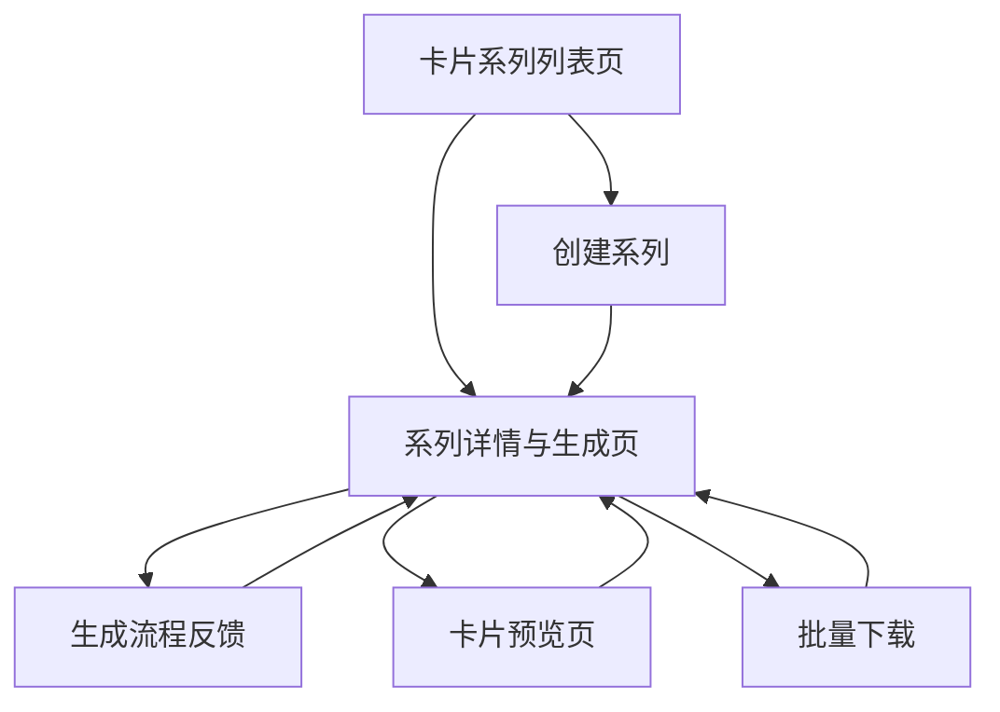

## 1. Product Overview
“AI图文卡片系列”模块用于批量生成风格统一的图文卡片，并以可追踪的流程反馈呈现生成进度与结果。
面向需要快速产出社媒/营销卡片的运营与设计协作场景，提升产能与可控性。

## 2. Core Features

### 2.1 Feature Module
本模块由以下核心页面组成：
1. **卡片系列列表页**：系列浏览与搜索、创建系列、快捷查看最近生成状态。
2. **系列详情与生成页**：配置生成参数、启动生成、流程进度与错误反馈、失败重试、批量下载与单张管理。
3. **卡片预览页**：单张卡片大图预览、文案复制、单张下载。

### 2.3 Page Details
| Page Name | Module Name | Feature description |
|---|---|---|
| 卡片系列列表页 | 系列列表 | 展示系列卡片（封面、名称、风格、数量、最近状态、更新时间）；支持按名称/标签搜索与状态筛选（生成中/成功/部分失败/失败）。 |
| 卡片系列列表页 | 创建系列 | 创建系列（名称、风格模板/主题、默认尺寸、默认卡片数量）；创建后进入系列详情。 |
| 系列详情与生成页 | 系列概览 | 显示系列信息与关键指标：目标数量、已成功数量、失败数量、进行中数量；显示最近一次生成的开始时间与耗时。 |
| 系列详情与生成页 | 生成配置 | 配置本次生成：数量、尺寸/版式（预设）、文案来源（手动输入/批量粘贴）、视觉风格（预设参数）；校验必填项并给出就地错误提示。 |
| 系列详情与生成页 | 生成流程反馈 | 启动生成后展示分阶段状态（排队→生成文案→生成图片→合成→上传→完成）；显示整体进度条、阶段提示语、可展开的日志/错误详情；支持后台运行与返回列表后仍可看到状态。 |
| 系列详情与生成页 | 失败处理与重试 | 对失败卡片展示失败原因与建议操作；支持“重试单张/重试失败项/重新生成全部”；重试需记录次数并在 UI 标注为重试任务。 |
| 系列详情与生成页 | 卡片结果网格 | 以网格展示生成结果（缩略图、标题/编号、状态角标）；支持按状态筛选、按时间排序；支持删除单张（可选）与重新生成单张。 |
| 系列详情与生成页 | 批量下载 | 支持选择全部/成功项/自选项；一键打包下载为 ZIP；下载前显示预计数量与体积提示；打包中显示进度与可取消。 |
| 卡片预览页 | 大图预览与操作 | 展示大图、关键文案字段；支持复制文案、下载单张、返回系列；当卡片处于生成中/失败时给出状态说明与可操作入口（返回重试）。 |

## 3. Core Process
**生成与反馈流程**：你从“卡片系列列表页”创建或进入一个系列，在“系列详情与生成页”填写生成配置并启动生成。系统将以分阶段状态与总体进度条反馈当前进展；若部分卡片失败，你可以查看失败原因并对失败项进行重试；生成成功后，你可以选择成功卡片进行批量打包下载，或进入单张预览页进行复制文案与单张下载。

**失败重试流程**：当卡片或任务失败时，页面在结果网格中标注失败项，并在侧边/弹窗中展示错误详情与建议。你可以选择重试单张或批量重试失败项；重试会生成新的任务并更新进度展示。

