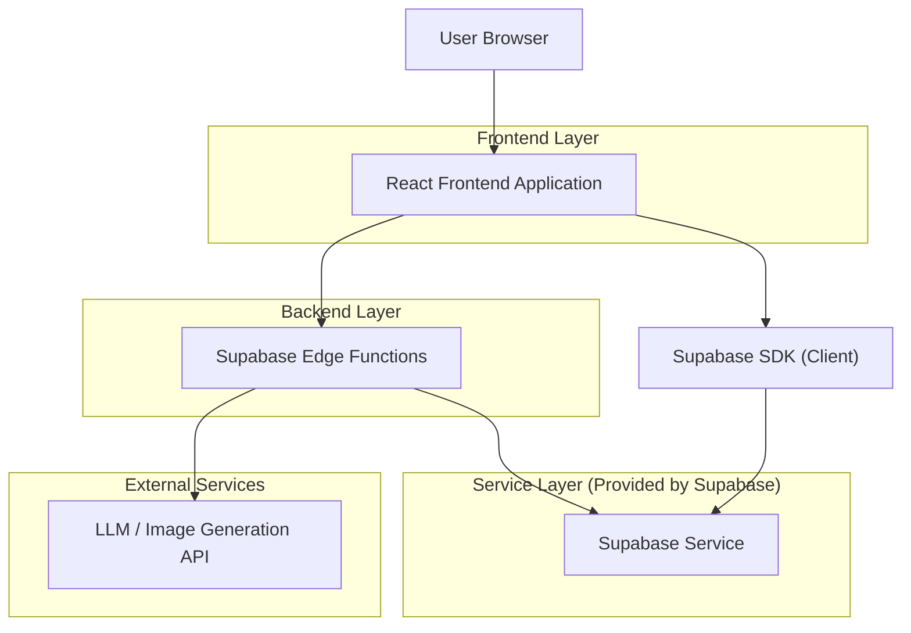
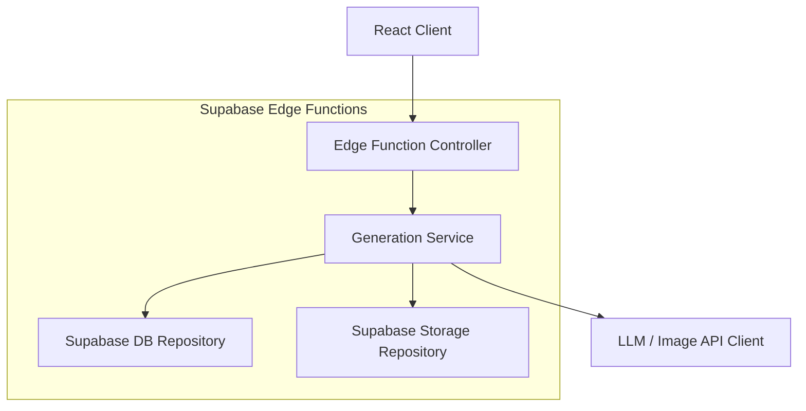
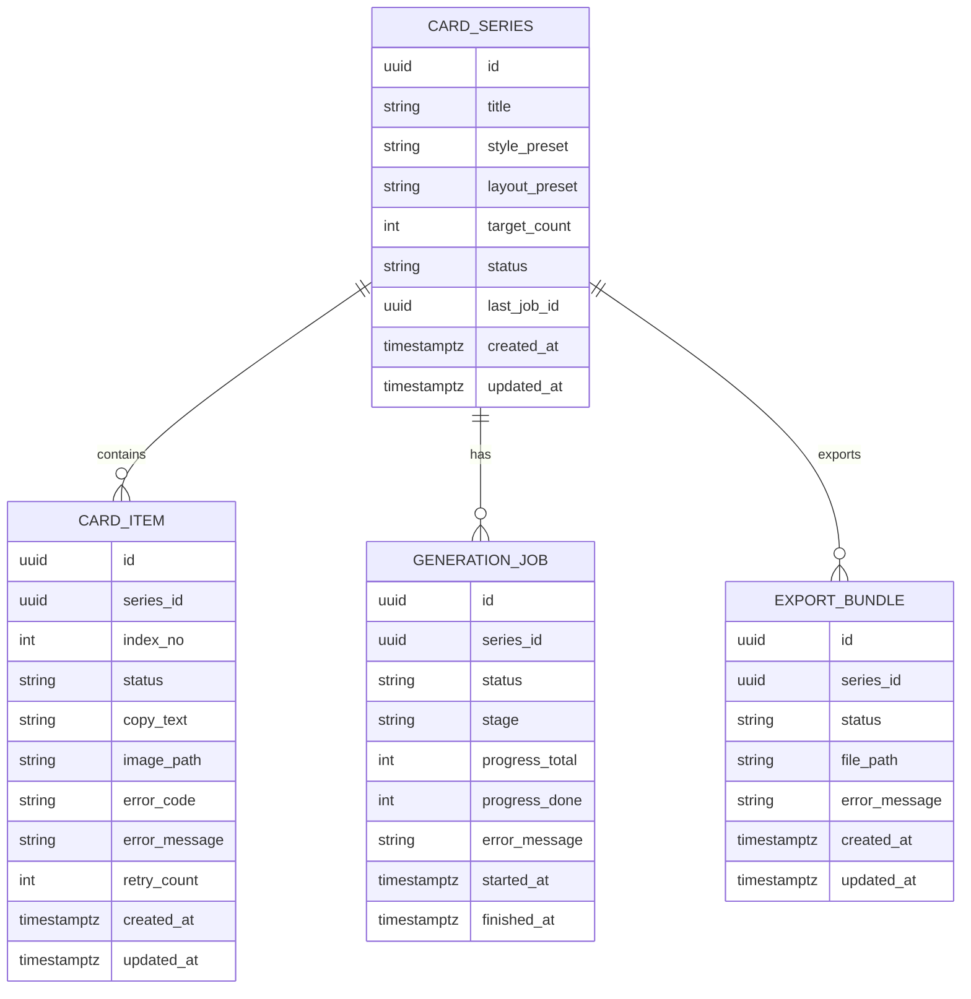

## 1.Architecture design


## 2.Technology Description
- Frontend: React@18 + TypeScript + vite + tailwindcss@3
- Backend: Supabase Edge Functions（用于安全调用生成模型与打包下载）
- Database & Storage: Supabase (PostgreSQL) + Supabase Storage（存储卡片图片与导出 ZIP）

## 3.Route definitions
| Route | Purpose |
|---|---|
| /series | 卡片系列列表页：浏览、搜索、创建系列、查看最近生成状态 |
| /series/:seriesId | 系列详情与生成页：配置生成、进度反馈、失败重试、结果管理、批量下载 |
| /series/:seriesId/cards/:cardId | 卡片预览页：大图预览、复制文案、单张下载 |

## 4.API definitions (If it includes backend services)
### 4.1 Core API
启动生成任务（为系列生成 N 张卡片）
```
POST /functions/v1/ai-cards/generate
```
Request（JSON）
| Param Name| Param Type | isRequired | Description |
|---|---|---|---|
| seriesId | string | true | 系列 ID |
| count | number | true | 本次生成数量 |
| layoutPreset | string | true | 版式预设（如 1:1 / 3:4 / 16:9 + 模板名） |
| copyInputs | string[] | false | 可选：用户提供的文案列表（用于一对一生成） |

查询生成任务状态（用于前端轮询或结果页刷新）
```
GET /functions/v1/ai-cards/jobs/:jobId
```

重试失败项
```
POST /functions/v1/ai-cards/retry
```
Request（JSON）
| Param Name| Param Type | isRequired | Description |
|---|---|---|---|
| seriesId | string | true | 系列 ID |
| cardIds | string[] | true | 需要重试的卡片 ID 列表 |

批量导出 ZIP
```
POST /functions/v1/ai-cards/export
```
Request（JSON）
| Param Name| Param Type | isRequired | Description |
|---|---|---|---|
| seriesId | string | true | 系列 ID |
| cardIds | string[] | true | 需要打包的卡片 ID 列表（前端可传“成功项/自选项”） |

### 4.2 Shared TypeScript Types
```ts
export type SeriesStatus = 'idle' | 'generating' | 'partial_failed' | 'succeeded' | 'failed'
export type CardStatus = 'queued' | 'generating_copy' | 'generating_image' | 'compositing' | 'uploading' | 'succeeded' | 'failed'

export interface CardSeries {
  id: string
  title: string
  style_preset: string
  layout_preset: string
  target_count: number
  status: SeriesStatus
  last_job_id?: string
  created_at: string
  updated_at: string
}

export interface CardItem {
  id: string
  series_id: string
  index_no: number
  status: CardStatus
  copy_text?: string
  image_path?: string
  error_code?: string
  error_message?: string
  retry_count: number
  created_at: string
  updated_at: string
}

export interface GenerationJob {
  id: string
  series_id: string
  status: 'running' | 'succeeded' | 'failed'
  stage: 'queued' | 'copy' | 'image' | 'compose' | 'upload' | 'done'
  progress_total: number
  progress_done: number
  error_message?: string
  started_at: string
  finished_at?: string
}

export interface ExportBundle {
  id: string
  series_id: string
  status: 'running' | 'succeeded' | 'failed'
  file_path?: string
  error_message?: string
  created_at: string
  updated_at: string
}
```

## 5.Server architecture diagram (If it includes backend services)


## 6.Data model(if applicable)
### 6.1 Data model definition


### 6.2 Data Definition Language
Card Series（card_series）
```
CREATE TABLE card_series (
  id UUID PRIMARY KEY DEFAULT gen_random_uuid(),
  title TEXT NOT NULL,
  style_preset TEXT NOT NULL,
  layout_preset TEXT NOT NULL,
  target_count INT NOT NULL DEFAULT 1,
  status TEXT NOT NULL DEFAULT 'idle',
  last_job_id UUID,
  created_at TIMESTAMPTZ NOT NULL DEFAULT now(),
  updated_at TIMESTAMPTZ NOT NULL DEFAULT now()
);

CREATE INDEX idx_card_series_updated_at ON card_series(updated_at DESC);
```

Card Item（card_items）
```
CREATE TABLE card_items (
  id UUID PRIMARY KEY DEFAULT gen_random_uuid(),
  series_id UUID NOT NULL,
  index_no INT NOT NULL,
  status TEXT NOT NULL DEFAULT 'queued',
  copy_text TEXT,
  image_path TEXT,
  error_code TEXT,
  error_message TEXT,
  retry_count INT NOT NULL DEFAULT 0,
  created_at TIMESTAMPTZ NOT NULL DEFAULT now(),
  updated_at TIMESTAMPTZ NOT NULL DEFAULT now()
);

CREATE INDEX idx_card_items_series_id ON card_items(series_id);
CREATE INDEX idx_card_items_status ON card_items(status);
```

Generation Job（generation_jobs）
```
CREATE TABLE generation_jobs (
  id UUID PRIMARY KEY DEFAULT gen_random_uuid(),
  series_id UUID NOT NULL,
  status TEXT NOT NULL DEFAULT 'running',
  stage TEXT NOT NULL DEFAULT 'queued',
  progress_total INT NOT NULL DEFAULT 0,
  progress_done INT NOT NULL DEFAULT 0,
  error_message TEXT,
  started_at TIMESTAMPTZ NOT NULL DEFAULT now(),
  finished_at TIMESTAMPTZ
);

CREATE INDEX idx_generation_jobs_series_id ON generation_jobs(series_id);
CREATE INDEX idx_generation_jobs_started_at ON generation_jobs(started_at DESC);
```

Export Bundle（export_bundles）
```
CREATE TABLE export_bundles (
  id UUID PRIMARY KEY DEFAULT gen_random_uuid(),
  series_id UUID NOT NULL,
  status TEXT NOT NULL DEFAULT 'running',
  file_path TEXT,
  error_message TEXT,
  created_at TIMESTAMPTZ NOT NULL DEFAULT now(),
  updated_at TIMESTAMPTZ NOT NULL DEFAULT now()
);

CREATE INDEX idx_export_bundles_series_id ON export_bundles(series_id);
```

权限建议（早期阶段，简单可用）
```
GRANT SELECT ON card_series TO anon;
GRANT SELECT ON card_items TO anon;

GRANT ALL PRIVILEGES ON card_series TO authenticated;
GRANT ALL PRIVILEGES ON card_items TO authenticated;
GRANT ALL PRIVILEGES ON generation_jobs TO authenticated;
GRANT ALL PRIVILEGES ON export_bundles TO authenticated;
```

Storage 约定
- Bucket: ai_card_assets
- 路径：series/{seriesId}/cards/{cardId}.png
- 导出：series/{seriesId}/exports/{exportId}.zip
